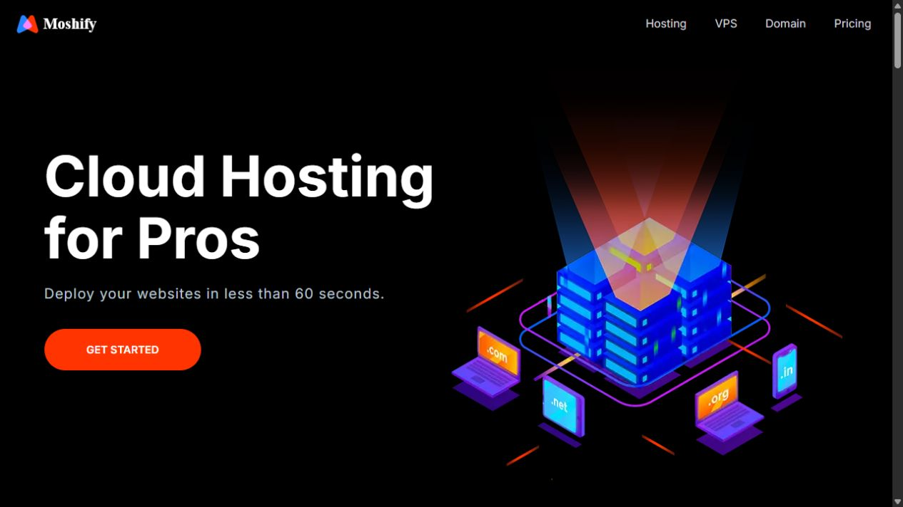

# Hesamify · captured evidence

Hosting landing-page hero and pricing layout. Educational UI; search and purchase controls do not provision hosting.



[Animated WebP](screenshots/portfolio.webp) · [GIF fallback](screenshots/portfolio.gif)

[Mobile PNG](screenshots/portfolio-mobile.png)

## Reproduce locally

Requires Python 3 and a modern browser. From the repository root:

```powershell
python -m http.server 8000 --bind 127.0.0.1
```

Open `http://127.0.0.1:8000/index.html`. Stop with Ctrl+C. No npm install, backend or database is needed for these checked-in static pages. CDN styles, fonts or scripts still require network access as described in the README. Forms were not submitted and external videos or social links were not activated.

Desktop captures used a 1280×720 browser viewport; mobile captures used 390×844. Scrollbars/backend capture scaling can make exported PNG dimensions slightly smaller. The checked homepages had no horizontal document overflow or broken image at those widths; this is not a comprehensive accessibility or browser-compatibility certification.

## Evidence boundary

Captured on 2026-10-28 from the checked-in implementation and clearly marked sample inputs. Animated media concatenates actual captured UI states with readable dwell times; it does not simulate a completed transaction. No production, cloud, database, payment, identity or email operation is implied. Static PNG is available above for reduced motion.
